<p align="center">
  
</p>

<h1 align="center">Code Alarm</h1>

<p align="center">
  <b>Your agent is done. Your phone rings.</b><br>
  A real alarm on your phone when Claude Code or Codex finishes, fails or needs you.
</p>

<p align="center">
  <a href="https://www.npmjs.com/package/code-alarm"></a>
  <a href="https://github.com/Draganoider/code-alarm/actions/workflows/ci.yml"></a>
  
  
  <a href="LICENSE"></a>
</p>

<p align="center">
  <a href="#quick-start">Quick start</a> ·
  <a href="#use-it">Use it</a> ·
  <a href="#how-it-works">How it works</a> ·
  <a href="#commands">Commands</a> ·
  <a href="docs/protocol.md">Protocol</a>
</p>

<p align="center">
  
</p>

Coding agents now work for an hour or more on their own. Their apps can *notify* you when they're
done, but Do Not Disturb swallows a notification and it only sounds once. **Code Alarm rings like an
alarm**, and only for the work you armed. Start a long task, go make dinner or go to sleep, and
come back when the agent actually needs you.

<table>
  <tr>
    <td width="33%" valign="top"><b>Only armed work rings</b><br>Sessions you didn't arm stay silent. Old and duplicate alerts never ring.</td>
    <td width="33%" valign="top"><b>Knows why it stopped</b><br><i>Done</i>, <i>needs you</i> (a question or a permission prompt), <i>failed</i> or <i>stopped</i>.</td>
    <td width="33%" valign="top"><b>Loud, or quiet</b><br>A repeating alarm by default, or one ordinary notification when you arm it with <code>quiet</code>.</td>
  </tr>
  <tr>
    <td valign="top"><b>Private by design</b><br>Only the event's kind, the folder's name and the agent leave your computer. No prompts, code or transcripts.</td>
    <td valign="top"><b>Never slows your agent</b><br>Hooks return at once and send in the background, so a bad network can't stall a session.</td>
    <td valign="top"><b>Free and open source</b><br>The CLI, the hooks and the Claude Code plugin are MIT, all in this repository.</td>
  </tr>
</table>

## Quick start

You need **Node.js 22 or newer** on the computer that runs your agent, and an app on your phone to
ring: the **Code Alarm app** or **ntfy**.

| | Code Alarm app | ntfy |
|---|---|---|
| **Phones** | Android | Android and iPhone |
| **Available** | In closed testing: [join the testers group](https://groups.google.com/g/code-alarm-testers), then [become a tester](https://play.google.com/apps/testing/dev.codealarm.app) | Now, free |
| **How it rings** | A full-screen alarm over the lock screen, on the alarm volume, with Stop and Snooze | ntfy's highest-priority alert, which keeps alerting once you turn that on |
| **Set up with** | `npx code-alarm pair` and a QR scan | `npx code-alarm init` and a topic subscription |

### 1. Connect your phone

**With the Code Alarm app.** Once you're in the test, install it from
[Google Play](https://play.google.com/store/apps/details?id=dev.codealarm.app), then run this
on your computer:

```bash
npx code-alarm pair
```

It shows a QR code. In the app, tap **Pair a computer**, then **Scan QR code**, and confirm. No
camera? Choose **Show a code instead** in the app and run `npx code-alarm pair <that code>`.

<details>
<summary><b>With ntfy</b> (Android or iPhone)</summary>
<br>

Create your private alarm channel:

```bash
npx code-alarm init
```

It prints a long random ntfy topic. Treat it like a password: anyone who knows it can ring your
phone. Install **ntfy** ([Google Play](https://play.google.com/store/apps/details?id=io.heckel.ntfy),
[F-Droid](https://f-droid.org/packages/io.heckel.ntfy/), [App Store](https://apps.apple.com/app/ntfy/id1625396347))
and subscribe to that topic. In the subscription's settings, turn on **keep alerting for the
highest priority** and the **Do Not Disturb override**.

</details>

Then ring it once to check:

```bash
npx code-alarm test
```

### 2. Connect your agent

**Claude Code:** add the plugin.

```bash
claude plugin marketplace add Draganoider/code-alarm
```

```bash
claude plugin install code-alarm@code-alarm
```

**Codex:** add user-level hooks and a skill, then open Codex and **trust the new hooks**.

```bash
npx code-alarm install codex
```

## Use it

Before a long task, arm it:

| Where | How |
|---|---|
| Claude Code | `/code-alarm:alarm`, then give it the task, or just say "wake me when it's done" |
| Codex | "Use the code-alarm skill and …", or "wake me when it's done" |
| Any terminal | `code-alarm arm` in the project folder, or `code-alarm nap 2h` to arm every session for two hours |

The agent ends its work with `done`, `needs-you` or `failed`, and your phone rings with that
reason. If it forgets, the alarm still rings when it stops, labelled *stopped*.

**Prefer a plain notification?** Say *quiet*: `/code-alarm:alarm quiet …`, "quietly notify me
when done", or `code-alarm arm --notify`. You get one normal notification with sound and
vibration, following your phone's sound settings, instead of the repeating alarm.

## How it works

<p align="center">
  
</p>

- **Arming decides.** Hooks fire for every session, but `code-alarm` only sends for work you
  armed. Arming a folder lasts until its first end-of-task alert; nap mode lasts until its time is
  up.
- **One small event.** An alert carries its kind, the folder's *name* (never a path), the agent,
  an ID and two timestamps. That's the whole [protocol](docs/protocol.md), and
  [a test](cli/test/privacy.test.ts) fails if anything else would leave.
- **Hooks stay out of the way.** They print nothing, always exit 0 and hand the send to a detached
  process, so the agent never waits on the network.
- **The app has the last word.** It ignores an alert that's expired (alerts live 30 minutes), or
  one it has already rung for.

Push is best-effort, as on any phone: a phone that's off, offline for a long time, or has the app
force-stopped won't ring. With the app, `code-alarm status --last` shows what happened to the last
alert: whether it rang, how long after it was sent, and when you stopped it.

## Commands

| Command | What it does |
|---|---|
| `code-alarm pair [<code>]` | Pair with the Code Alarm app, by QR or by the code the app shows |
| `code-alarm init` | Create a private ntfy topic instead, and show how to subscribe |
| `code-alarm test [--notify]` | Ring the phone now, or send a plain notification |
| `code-alarm arm [--for 12h] [--notify]` | Ring when the agent in this folder next finishes, stops or needs you |
| `code-alarm nap 2h [--notify]` | Ring for every session until the time is up |
| `code-alarm disarm [--all]` | Cancel arming for this folder, or everything |
| `code-alarm status [--last]` | What's set up, what's armed, and the last alerts |
| `code-alarm use ntfy\|app` | Switch between ntfy and the app when both are set up |
| `code-alarm unpair` | Remove this computer from the phone |
| `code-alarm install codex` | Add the hooks and skill to Codex (`uninstall codex` removes them) |

`code-alarm --help` lists every option.

## Troubleshooting

- **Nothing rings after you reinstalled the app or cleared its data.** The phone registered
  afresh, so this computer's pairing points at the old install. `code-alarm status` and
  `code-alarm test` say so. Pair again with `code-alarm pair`, and remove the old computer from the
  app's list.
- **Codex stopped alerting after an update.** Codex's hooks run their own copy of code-alarm.
  `code-alarm status` says when it's out of date, and `init`, `pair`, `unpair` and `use` refresh
  it for you.
- **Anything else:** `code-alarm status` shows the last alerts and what happened to them. Bugs and
  ideas are welcome in [issues](https://github.com/Draganoider/code-alarm/issues).

## Develop

```bash
cd cli
npm install
npm run check
```

`npm run check` type-checks, runs the tests, and builds the bundle into `cli/dist/` and the Claude
Code plugin. The bundled files are committed, because plugins install straight from the repository.
To try your working copy in Claude Code: `claude --plugin-dir plugins/claude-code`. The rules for
contributors, human or AI, are in [AGENTS.md](AGENTS.md).

## License

[MIT](LICENSE). Not affiliated with Anthropic or OpenAI.

The CLI bundles Project Nayuki's [QR Code generator library](https://www.nayuki.io/page/qr-code-generator-library)
(MIT), to draw the pairing QR in the terminal. Its notice is kept in `cli/src/vendor/qrcodegen.ts`
and at the end of the bundle.
