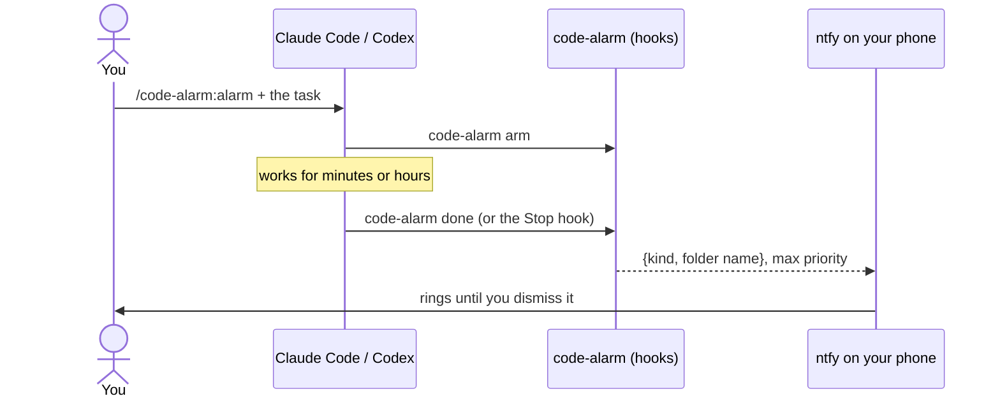

<h1 align="center">Code Alarm</h1>

<p align="center">
  <b>Start a long agent task, walk away, and get woken up when it's done.</b><br>
  A real alarm on your phone when Claude Code or Codex finishes or needs you.
</p>

<p align="center">
  <a href="https://github.com/Draganoider/code-alarm/actions/workflows/ci.yml"></a>
  
  
  
</p>

---

Coding agents now work for an hour or more on their own. Their phone apps will *notify* you when
they're done, but Do Not Disturb swallows a notification and it rings once. **Code Alarm rings like
an alarm**, until you dismiss it, and only for work you armed.

- **One command to arm:** `/code-alarm:alarm` in Claude Code, or ask Codex to use the code-alarm
  skill. Sessions you didn't arm stay silent.
- **Knows why it stopped:** *done*, *needs you* (a question or a permission prompt), *failed*, or
  *stopped*.
- **Nothing leaves your computer** except the event type and the project folder's name: no prompts,
  code, paths or transcripts ([protocol](docs/protocol.md)).
- **Never slows your agent down:** hooks return at once and send in the background. A network
  problem can't stall a session.
- **Free:** it rings your phone through the [ntfy](https://ntfy.sh) app today. A dedicated Code
  Alarm Android app is coming.

## Set up (5 minutes)

You need **Node.js 22 or newer** on the computer that runs your agent.

**1. Create your private alarm channel:**

```bash
npx code-alarm init
```

It prints a long random ntfy topic. Treat it like a password: anyone who knows it can ring your
phone.

**2. On your phone:** install **ntfy** ([Google Play](https://play.google.com/store/apps/details?id=io.heckel.ntfy),
[F-Droid](https://f-droid.org/packages/io.heckel.ntfy/), [App Store](https://apps.apple.com/app/ntfy/id1625396347))
and subscribe to that topic. In the subscription's settings, turn on **keep alerting for the
highest priority** and the **Do Not Disturb override**. Then check it:

```bash
npx code-alarm test
```

**3. Connect your agent.**

Claude Code:

```bash
claude plugin marketplace add Draganoider/code-alarm
```

```bash
claude plugin install code-alarm@code-alarm
```

Codex (adds user-level hooks and a skill; open Codex afterwards and **trust the new hooks**):

```bash
npx code-alarm install codex
```

## Use

Before a long task, arm it:

| Agent | How |
|---|---|
| Claude Code | `/code-alarm:alarm`, then give it the task (or say "wake me when it's done") |
| Codex | "Use the code-alarm skill and …", or "wake me when it's done" |
| Any terminal | `code-alarm arm` in the project folder; `code-alarm nap 2h` arms every session for 2 hours |

**Prefer a plain notification?** Say *quiet*: `/code-alarm:alarm quiet …`, "quietly notify me
when done", or `code-alarm arm --notify`. You get one ordinary notification instead of the alarm.

The agent ends its work with `done`, `needs-you` or `failed`, and your phone rings with that
reason. If it forgets, the alarm still rings when it stops, labelled *stopped*.

`code-alarm status` shows what's set up, what's armed and the last alerts. `code-alarm disarm`
cancels arming.

## How it works



Details: [event protocol](docs/protocol.md) · [agent integration notes](docs/agents.md).

## Develop

```bash
cd cli
npm install
npm run check
```

`npm run check` type-checks, runs the tests, and builds the bundle into `cli/dist/` and the Claude
Code plugin. The bundled files are committed, because plugins install straight from the repository.
To try your working copy in Claude Code: `claude --plugin-dir plugins/claude-code`.

## License

[MIT](LICENSE). Not affiliated with Anthropic or OpenAI.
